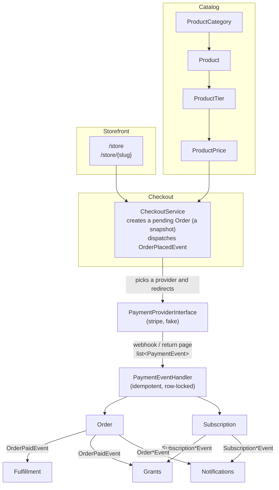

# Ecommerce plugin

A generic ecommerce plugin for forumify: a catalog of digital and physical products, a storefront,
checkout through pluggable payment providers, subscriptions, and fulfillment.

These are developer docs, one per feature. Each one describes what the feature does, the domain model
behind it, its extension points, and the decisions that shaped it (with the reasoning, so they can be
revisited on purpose rather than by accident).

For store admins there is a separate user manual at
[docs.forumify.net](https://docs.forumify.net/plugins/ecommerce-plugin/introduction): how to set up the store,
connect Stripe and run it day to day. When a change alters what an admin sees or does, update the manual too
(it lives in the `forumify-docs` repository, under `src/app/plugins/ecommerce-plugin`).

forumify.net is the first target user, and once the plugin is mature it can drop its custom implementation
and build its marketplace and hosting on top. Its code is a *reference* only: it shows what worked in
production and which shortcuts hurt. It is not a codebase to extract from.

## The docs

| Doc | Covers |
| --- | --- |
| [configuration.md](configuration.md) | Plugin wiring, permissions, routing, store settings, money handling |
| [catalog.md](catalog.md) | Categories, products, tiers, prices, images, and the admin CRUD |
| [storefront.md](storefront.md) | `/store` catalog and product pages, SEO and link embeds |
| [cms-widgets.md](cms-widgets.md) | Page builder widgets: product, category, pricing table, buy button, search |
| [checkout-and-orders.md](checkout-and-orders.md) | The checkout flow, the `Order` entity, buyer and admin order pages |
| [payment-providers.md](payment-providers.md) | `PaymentProviderInterface`, `PaymentEvent`, the registry, `PaymentEventHandler`, the fake provider |
| [stripe.md](stripe.md) | The Stripe provider: catalog sync, checkout sessions, webhooks |
| [subscriptions.md](subscriptions.md) | Subscription lifecycle, renewal orders, cancellation, past-due grace |
| [fulfillment.md](fulfillment.md) | Fulfillment types, `FulfillmentService`, the paid → completed gap |
| [self-service.md](self-service.md) | What buyers do after buying: settle a payment, invoices, cancelling, refunds |
| [notifications.md](notifications.md) | Buyer and admin notifications |
| [revenue-caps.md](revenue-caps.md) | Plugin tiers, the revenue limit, exchange rates |
| [dashboard.md](dashboard.md) | The admin dashboard: work waiting, revenue, MRR, product sales, top customers |
| [grants.md](grants.md) | Granting and revoking roles and badges on purchase |
| [roadmap.md](roadmap.md) | Deliberately out of scope, and designs that aren't built yet |

## How it fits together

Three rules run through the whole plugin:

- **The provider is the source of truth for money.** Every state change caused by a payment arrives as a
  `PaymentEvent` and is applied by `PaymentEventHandler`, whichever provider it came from and whether it
  reached us through a webhook or a return-page sync.
- **State changes are idempotent.** Webhooks retry, arrive out of order, and race with the return page.
  Every transition reports whether it actually changed anything, and plugin events are only dispatched
  when something did.
- **Orders are snapshots.** An order records what was sold (product key, tier key, amount, currency,
  interval, fulfillment data) as plain values. Catalog links are `SET NULL`, so editing or deleting a
  product never damages order history.

## Conventions

Code conventions (entities with public typed properties, money in minor units, phpcs/phpstan setup,
testing approach) live in the repo's `AGENTS.md`.
